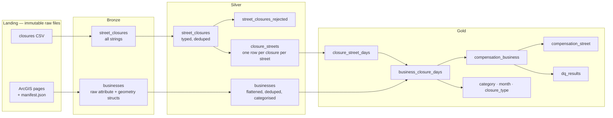

# Tel Aviv street-closure compensation — PySpark medallion pipeline

Compensation owed to Tel Aviv businesses for street closures in 2023, built as a Bronze → Silver → Gold pipeline in PySpark. It runs locally (Parquet) or on Databricks (Delta in Unity Catalog, scheduled as a job).

| | Model A — the brief, literally | Model B — adjusted |
|---|---:|---:|
| **Total 2023 compensation** | **8,961,475,700 ₪** | **5,128,650,220.67 ₪** (57.2% of A) |
| Businesses compensated | 12,165 | 12,165 assessed, non-trading premises pay 0 |
| Streets | 94 | 94 |
| Cost per sqm of affected floor area | 1,384 ₪ | — |

Both totals are cross-checked to the agora against an independent plain-Python implementation (`tests/independent_oracle.py`).

The two required outputs are `gold_compensation_business` (per business) and `gold_compensation_street` (per street). CSV copies are in `output/exports/`.

---

## Quick start

**Local** (Python 3.10+, Java 17+):

```bash
pip install -r requirements.txt
python ingest/download_businesses.py --out landing/businesses   # needs network access to gisn.tel-aviv.gov.il
PYTHONPATH=src python -m tlv_pipeline.run                        # bronze -> silver -> gold -> quality -> insights, ~50s
PYTHONPATH=src pytest -q tests/                                  # 14 tests
```

The landing data from the run behind these results is already in `landing/`, so the download step is optional.

**Databricks** (works on Free Edition, serverless):

1. Push this repo to GitHub and add it as a Git folder (Workspace → Create → Git folder).
2. Run `notebooks/00_setup.py`. It creates the schema `workspace.tlv` and the `landing` volume, then copies the repo's `landing/` files (closures and businesses) into the volume. It only copies files that aren't there yet, so it never overwrites data landed later. The category map is configuration, so it's read from `conf/` in the repo, both locally and on Databricks.
3. Run `01_bronze` → `04_quality` interactively, or deploy the scheduled job: `databricks bundle deploy -t dev` (schedule paused) or `-t prod` (schedule live), then `databricks bundle run tlv_compensation -t dev`.

Each notebook finds the repo root by itself. It checks the `repo_root` job parameter first, then `sys.path`, then the notebook path, because the working directory of a serverless task isn't guaranteed. The notebooks were run locally against a mock `dbutils` and a Spark Connect session (the protocol serverless uses), with the working directory set to `/`, in both Git-folder and bundle layouts. Totals were identical.

Why the download runs outside Databricks: Free Edition only allows outbound traffic to a list of trusted domains, and the municipal GIS server refuses requests from some regions. Ingestion therefore lands files in object storage and Databricks processes them. This is the same split you'd use with ADF or a self-hosted runner in production, so the scheduled job never depends on the source being reachable at run time.

---

## Architecture



| Table | Grain | Notes |
|---|---|---|
| `bronze_street_closures` | one row per CSV record | Strings only, plus `_source_file` and `_ingested_at` |
| `bronze_businesses` | one row per API feature | ArcGIS `attributes` / `geometry` structs untouched, plus `_run_id` |
| `silver_street_closures` | one row per valid, distinct closure event | |
| `silver_street_closures_rejected` | one row per rejected record | Carries `reject_reason` |
| `silver_closure_streets` | one row per closure per affected street | Rule 5: both streets matched independently |
| `silver_businesses` | one row per `business_id` | Latest record kept |
| `gold_closure_street_days` | one row per (street, day) in 2023 | |
| `gold_business_closure_days` | one row per (business, day) | Rule 2: once per business per day |
| `gold_compensation_business` | one row per business | **Output 1** |
| `gold_compensation_street` | one row per street | **Output 2** |

Every layer is rebuilt from the one below it, so a re-run of any layer is idempotent. Bronze keeps every landing run, and Silver's dedup picks the latest record for each business. Storage is behind one small class (`storage.py`): Parquet paths locally, Unity Catalog Delta tables on Databricks.

---

## Getting the business data

**The API URL in the brief returns 5% of the data.** The layer caps each response at `maxRecordCount = 2000`, but it holds 37,356 features. A single `where=1=1&outFields=*&f=json` call returns the first 2,000 and quietly sets `"exceededTransferLimit": true`.

`ingest/download_businesses.py` handles this:

- It pages with a **keyset on OBJECTID** (`WHERE OBJECTID > last ORDER BY OBJECTID`). Unlike offset paging, this stays correct if rows change between calls.
- It writes each page to disk byte-for-byte as received, and records a per-file SHA-256 in `manifest.json`.
- It retries ArcGIS errors returned inside HTTP 200 responses, which the API does.
- It verifies its own output: the downloaded total and the unique OBJECTIDs must both equal `returnCountOnly`, or it exits non-zero. The quality step re-checks this against the manifest.
- It leaves out the owner name and owner ID fields at source. They are personal data and the brief marks them unused. `--include-pii` adds them back.

---

## What the data actually looks like

These came out of profiling the real files before writing the transformations. Each is handled in Silver and counted in `gold_dq_results`.

**Closures CSV**
- **Dates are `dd/MM/yyyy H:mm`.** Parsed with an explicit format, since a default parser silently swaps day and month. 6 rows have no end date, so the end date is set to the start date (as the brief says).
- **The CSV escapes quotes by doubling them** (`תרס""ט`). Spark's default escape character is a backslash, so `escape='"'` is required.
- **133 rows have no usable street at all**: code and name are both `0`. They are rejected with the reason recorded. Another 69 have street A but no street B, and keep A.
- **The two street columns are the *bounding cross-streets*, not the closed street.** `me_shem_rechov` / `ad_shem_rechov` mean "from street" / "to street": the closed segment (`id_rechov`) runs *between* them, and its own street name isn't in the file. The free text confirms it in several 2023 rows: ID 1511 is `טרומפלדור / אלנבי` but says Ben Yehuda (`בן יהודה`) is closed; ID 1309 is `קרליבך / קפלן` but the works are on Ibn Gabirol; IDs 432 and 461 name Zerach (`זרח`) and HaMasger (`המסגר`). Rule 5 tells us to compensate both listed streets, so Model A does exactly that, but in practice it pays the cross-streets and often misses the street that was actually closed. Fixing it needs the city's street-segment layer to turn `id_rechov` into a street; the free text is too irregular to parse reliably. See insight 2.
- **8 rows duplicate another event**: same segment (`id_rechov`), streets, dates, type and hours, different `ID`. The first is kept. An earlier version left the segment out of the key and rejected 67 rows, but 59 of those were closures of *different* segments between the same two streets. Totals don't change either way, because rule 2 collapses everything to one payment per street per day; the oracle, which skips this dedup, produces the same totals.
- **152 `sw_laila` values are corrupted.** Unescaped commas inside the hours text pushed free text into the column. They are set to NULL and flagged.
- **Filter by overlap with 2023, not by start year.** 65 closures start in 2023, but 84 overlap it. The 19 that started earlier include the largest closures in the file, some running from mid-2020 to the end of 2023.

**Businesses API**
- `date_import` is a **string** (`dd/MM/yyyy HH:mm:ss`), despite the data dictionary calling it a timestamp. `tr_hakama` is epoch milliseconds.
- Every row in one snapshot shares the same `date_import`. So "keep the latest" needs a deterministic tie-break: latest landing run, then highest OBJECTID.
- Some category values are wrapped in a stray pair of quotes (`"משרד השמה וכ"א"`).
- The dictionary's translation table covers 24 categories with spellings that don't match the data (`קיוסק` vs `קיוסקים`). The data has 191 categories; `conf/category_map.csv` maps all of them.
- **The join uses street name only**, because the business layer has no street code. Both sides go through the same normalisation: Hebrew gershayim and geresh unified to ASCII quotes, whitespace collapsed, `0` treated as missing. 93.1% of the streets closed in 2023 match exactly. The 7 that don't (squares and code-only names such as `הבימה` and `1235`) are listed in `gold_dq_unmatched_streets`. There is deliberately **no fuzzy matching**, because a wrong match pays the wrong business.

---

## Business rules → implementation

| # | Rule | Where | How |
|---|---|---|---|
| 1 | Eligible on days its street appears in closure data | `gold.business_closure_days` | Inner join on the normalised street name to `closure_street_days` |
| 2 | Once per business per day | `gold.closure_street_days` | Grouped to (street, day) before the join; the uniqueness of (business, day) is asserted |
| 3 | 100 ₪ per sqm per day | `conf/pipeline.yml` | `rate_ils_per_sqm_per_day` |
| 4 | Max 10,000 ₪ per business per day | `conf/pipeline.yml` | `least(rate × area, cap)`, asserted ≤ cap on every row |
| 5 | Both streets in a row are affected | `silver.closure_streets` | Street A and street B unpivoted into separate rows |
| 6 | 2023 only | `gold.closure_street_days` | Overlap filter, then each closure is expanded to days clipped to 2023 |

**Interpretations, stated rather than assumed silently:**
- "At least 100 ₪ per sqm" is implemented as exactly 100 ₪ per sqm, so the brief's own example (25 sqm × 2 days = 5,000 ₪) reproduces. It is a test case.
- A business with area 0 or null receives 0. There is one.
- Closure hours don't affect Model A, because the rules are day-based. Model B uses them.
- Multi-day closures use their daily hours window on every day in the range.

---

## Two compensation models

**Model A** applies the rules exactly as written. It is the required output.

**Model B** keeps the same rate and cap, and corrects three things the literal rule ignores:

1. **Non-trading premises get nothing.** That covers transformer rooms, warehouses, free parking, closed units, municipal departments and places of worship. There are 34 categories, set in `conf/category_map.csv` (`model_b_eligible`), so the list is a reviewable config change rather than code.
2. **No compensation before a business existed.** The API is a current (2026) snapshot, so it includes businesses established after 2023.
3. **The daily amount is scaled by the share of trading hours (08:00–20:00) the closure covered.** A `04:00–14:00` marathon closure pays 50%, a 24-hour closure 100%, a night-only closure 0%. Hours that can't be parsed get 100%, giving the business the benefit of the doubt.

How each adjustment moves the total:

| Step | ₪ | Share of A |
|---|---:|---:|
| Model A | 8,961,475,700 | 100% |
| − non-trading premises | −955,259,900 | −10.7% |
| − days before the business existed | −2,455,720,100 | −27.4% |
| − hours outside trading time | −421,845,479 | −4.7% |
| **Model B** | **5,128,650,221** | **57.2%** |

---

## Metrics

- **Cost per area:** total compensation ÷ floor area, per business and per street, for both models. Across all affected businesses it is **1,384 ₪/sqm** under Model A. Note that per business it is nearly constant (100 ₪ × days) until the cap binds, so it is most informative at street level and for capped businesses.
- **Cap binding:** 42.4% of compensated businesses (5,164, all ≥ 100 sqm) hit the 10,000 ₪ daily cap, and they receive 57.2% of Model A.
- **Days affected, average daily payment, concentration, and Model B as a share of A**, per business and per street.
- **By month, by category and by closure type:** separate gold tables.

---

## Insights

1. **Under the literal rule, the bill exceeds the city's whole operating budget.** Model A comes to 8.96 billion ₪ for one year of closures. Tel Aviv-Yafo's entire regular municipal budget for 2022 was 5.84 billion ₪.
2. **The cause is rule 5's street-level scope, not the rate.** Each row names the two cross-streets that bound a closed segment, and rule 5 makes *every* business along both of them eligible, for their whole length, while the closed street itself usually isn't named (see "What the data actually looks like"). אבן גבירול, הרצל and השוק are listed as closed for all 365 days of 2023, so all 806 businesses on אבן גבירול qualify every day. **Five streets take 62.4% of Model A.** A proximity version using the businesses' Israeli-grid coordinates would be the natural next model.
3. **The biggest correction is about time, not rate.** 3,437 compensated businesses were established after 2023, and they receive 2.44 billion ₪ under Model A. The opposite error can't be fixed from this source: businesses that existed in 2023 but have since closed are missing from a 2026 snapshot. Paying 2023 claims correctly needs a point-in-time business register.
4. **Light-rail works dominate.** Days attributed to NTA light-rail closures account for 3.85 billion ₪ of Model A (43%). Monthly totals fall from 1.04 billion ₪ in January to 345 million ₪ in December, which is consistent with the Red Line opening on 18 August 2023.
5. **Marathons are a rounding error.** Marathon events close 41 streets but come to 40 million ₪, because they are single half-day events. Model B pays half of that day, reflecting the 04:00–14:00 window.
6. **955 million ₪ under Model A goes to premises that don't trade**, including 129 million ₪ to 355 electrical transformer rooms.
7. **483 businesses hit the maximum of 3.65 million ₪**, which is 365 days at the daily cap.

---

## Data quality and testing

- **17 checks** run after every pipeline run and are written to `gold_dq_results`. Any `fail` raises an error and stops the scheduled job. They cover:
  - completeness against the server's count
  - business-ID uniqueness
  - date parsing
  - street match rate
  - one row per business per day
  - every day inside 2023
  - daily amount within [0, cap]
  - Model B never above Model A
  - totals reconciling across the business-day, business and street grains
- **Completeness is checked per download.** Bronze keeps every landed run, so the count check compares the latest run with the latest manifest. Comparing all of bronze would fail the gate the day a second download lands.
- **A missing manifest is a warning, not a pass.** An early version passed silently when the manifest couldn't be found, because Spark hides files starting with `_`. The file was renamed and the check fixed.
- **15 unit tests** (`tests/test_pipeline.py`). They cover normalisation, the trading-hours factor (including windows that cross midnight), every cleaning rule, and the compensation rules on hand-built inputs (year clipping, once per day, the cap, eligibility, establishment date), plus an end-to-end comparison with the independent oracle.
- **Independent oracle** (`tests/independent_oracle.py`): plain Python, no Spark, reading straight from the raw landed files. It matches Model A exactly per business. It matches Model B to the agora once both round each day's payment.

---

## Bonus tasks

| | |
|---|---|
| **Databricks** | `notebooks/` are thin wrappers over the same package the local run and the tests use, writing Unity Catalog Delta tables |
| **Scheduler** | `databricks.yml` is an Asset Bundle with a 5-task job (setup → bronze → silver → gold → quality), running daily at 06:00 Asia/Jerusalem on serverless, with the quality task as the gate. The `dev` target pauses the schedule and the `prod` target runs it |
| **Dashboard** | `dashboard/index.html` is a standalone dashboard, rebuilt from `output/insights.json` on every local run (`dashboard/build_dashboard.py`). `dashboard/queries.sql` holds the datasets for a Databricks AI/BI dashboard, which reads the gold tables directly |
| **Insights** | `tlv_pipeline.insights`, recomputed on every run into `output/insights.json`; summarised above |

---

## Production next steps

- Use Auto Loader on the landing volume instead of full rebuilds once the history of runs grows. Add liquid clustering on `(street_key, day)` for `business_closure_days`.
- Get a point-in-time business register so 2023 claims are paid against the businesses that existed in 2023.
- Resolve `id_rechov` to the actually closed street through the city's street-segment layer, then add a proximity model: compensate businesses within a set distance of the closed segment instead of along the whole of both cross-streets.
- Model B refinements the data supports but this version doesn't attempt: closures that apply only on some weekdays (e.g. the Nahalat Binyamin evening pedestrian zone), and one-way or single-lane changes (`k_sgira`, mostly code 2 in 2023) paid like full closures.
- Write the DQ results append-only to track trends across runs, and alert on match rate and row-count drift.

---

## Repository layout

```
conf/            pipeline.yml (every business rule is a parameter) · category_map.csv (191 categories)
ingest/          download_businesses.py — paginated, retrying, self-verifying ArcGIS download
src/tlv_pipeline bronze · silver · gold · quality · insights · storage · normalize · config · run · databricks
notebooks/       00_setup … 04_quality — Databricks notebook tasks
explore/         silver/gold step-by-step notebooks + SQL: every intermediate DataFrame shown and checked (not part of the job)
tests/           test_pipeline.py · independent_oracle.py
dashboard/       template.html + build_dashboard.py → index.html · queries.sql (Databricks AI/BI datasets)
landing/         the raw files this run used
output/          parquet tables by layer · exports/*.csv · insights.json
databricks.yml   Asset Bundle: scheduled job
```
